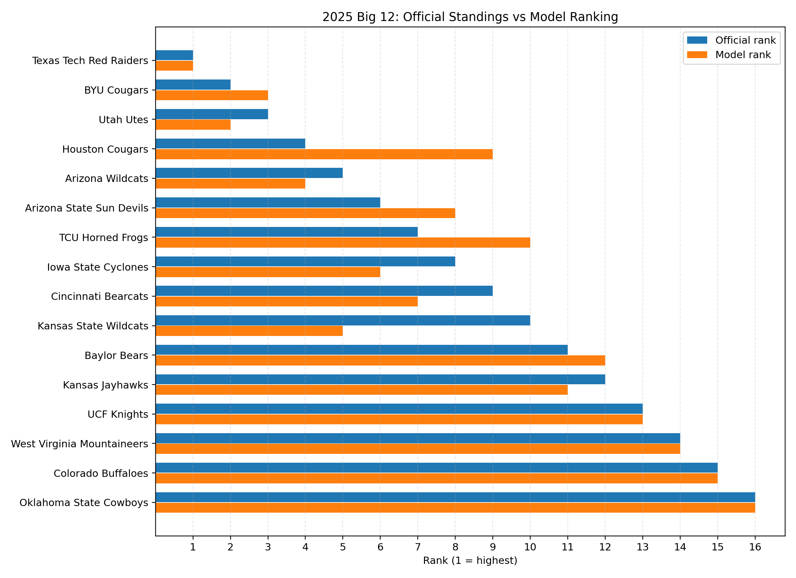
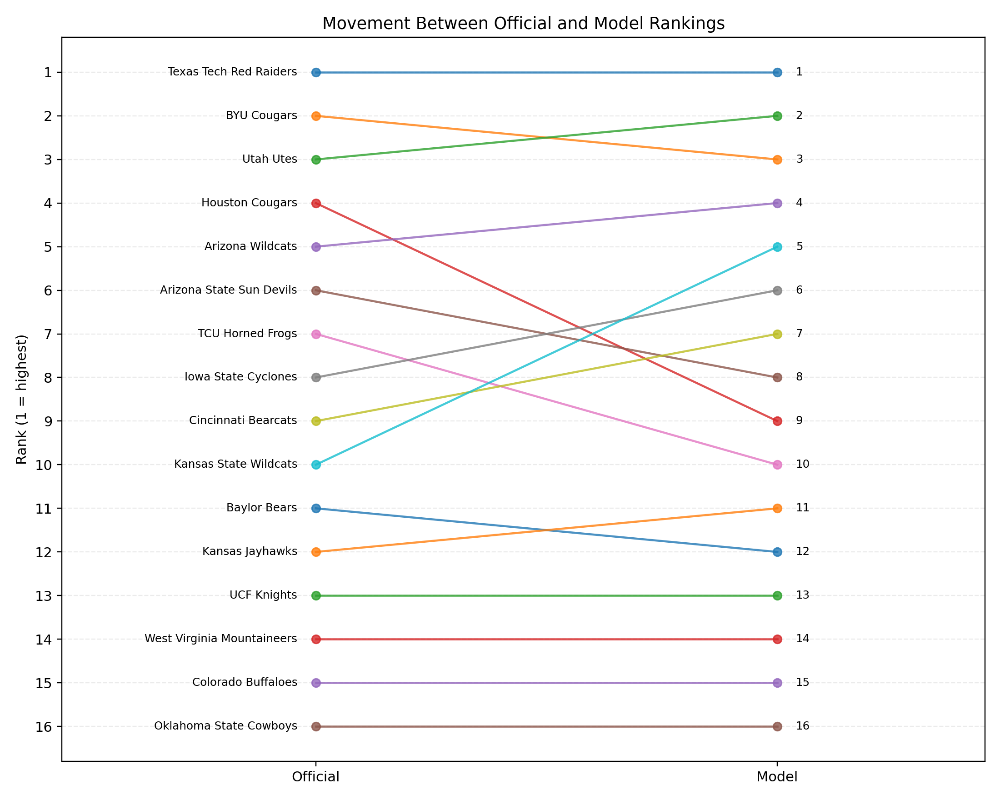
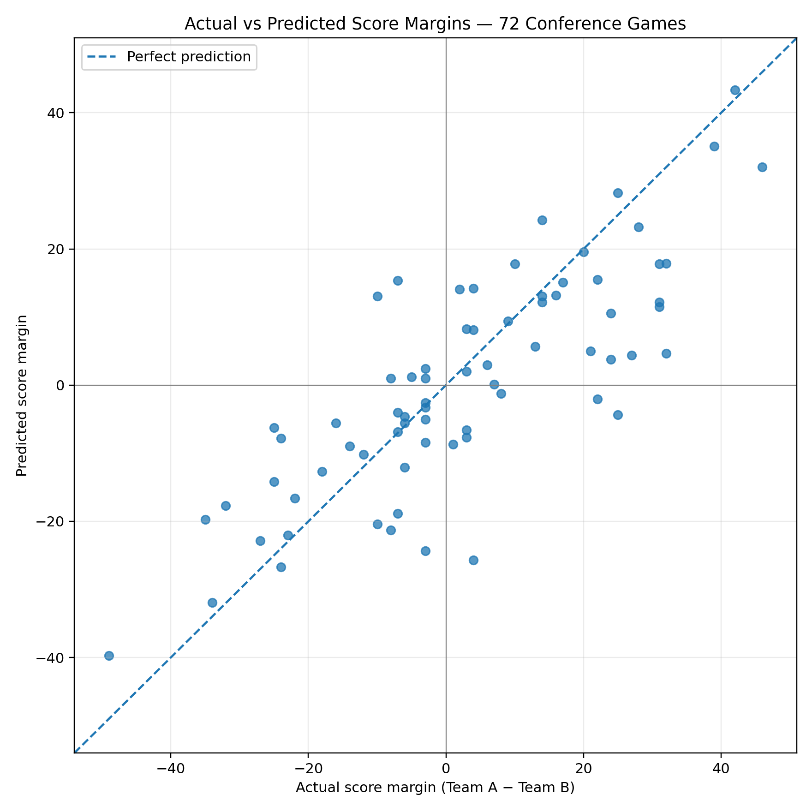

# 2025 Big 12 Football — Mathematical Ranking Analysis

A score-margin-based mathematical model estimating relative strength for the 16 teams in the 2025 Big 12 conference.

## Main findings
- Top model team: Texas Tech Red Raiders (+25.77)
- Utah (+17.97) and BYU (+10.29) complete the top three.
- In-sample MAE: 9.25 points; RMSE: 12.04 points.
- In-sample winner accuracy: 59/72 (81.9%).
- Held-out championship: predicted Texas Tech by 15.48; actual result Texas Tech 34–7 BYU (27-point margin).

> MAE, RMSE and winner accuracy are in-sample: the 72 games were used both to fit and evaluate the model. These values may be optimistic.

## Visual results
### Official vs model rankings

### Ranking movement

### Actual vs predicted margins


## Structure
```text
Big12-Football-Analysis/
├── data/Big12_Match_Data.xlsx
├── figures/
├── notebook/analysis.ipynb
├── report/Big12_Football_Mathematical_Analysis_Report.pdf
├── results/
├── src/big12_ranking.py
├── requirements.txt
└── README.md
```

## Run locally
Python 3.10+ recommended. From the repository root:
```bash
pip install -r requirements.txt
python src/big12_ranking.py
```

The script reads `data/Big12_Match_Data.xlsx` and writes outputs to `results/`.

## Model
For a game between Team A and Team B, `r_A - r_B ≈ score_A - score_B`. The 72 game equations are solved by least squares, with `sum(r_i) = 0` to set a common rating scale.

## Limitations
Home advantage, injuries and player availability are not modelled. The official comparison depends on the standings order supplied for the analysis. In-sample fit metrics are not a substitute for testing on a larger unseen sample.

## Data note
The dataset used in this project is included in the `data/` directory.
It contains the 2025 Big 12 football match results used for mathematical modelling and ranking analysis.
